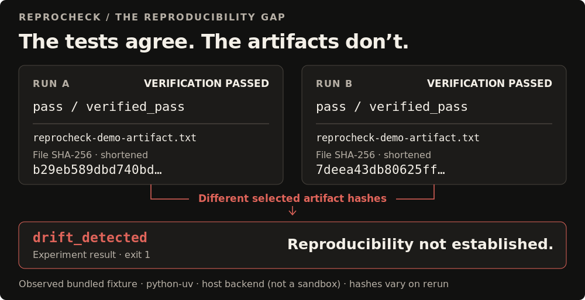
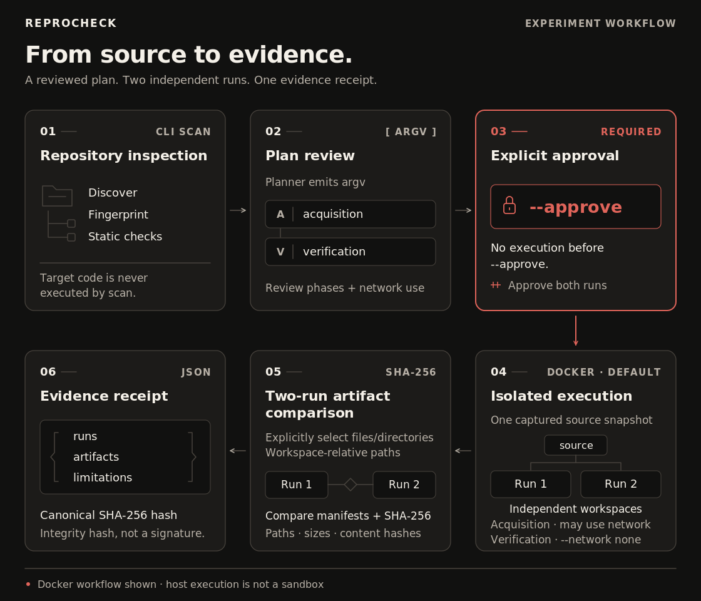

# ReproCheck

**Passing tests doesn't prove reproducibility.**

ReproCheck runs approved verification plans twice in independent workspaces,
compares selected artifacts, and records inspectable evidence—not just an exit code.

[](pyproject.toml)
[](LICENSE)

[Quick start](#quick-start) · [Drift demo](#live-demo-detect-artifact-drift) ·
[Architecture](#architecture) · [Security](#security-and-trust-boundaries)


*Actual CLI output, faithfully rendered from an 86-column terminal capture.
[Capture details and SVG source](docs/assets/README.md#1-real-cli-welcome).*

## Why two passing runs can still drift

A test can pass while its output contains a timestamp, a random identifier, or
another changing value. Command success answers **“did verification pass?”**
Artifact comparison asks **“did both runs produce the same selected output?”**



The bundled Python fixture demonstrates exactly this gap: **two `verified_pass`
runs, different artifact hashes, `drift_detected`.** Neither passing run is
relabeled as a test failure; the pair-level reproducibility conclusion is negative.

*The illustrated hashes come from a real `python-uv` experiment using the
explicitly acknowledged host backend—not a Docker capture. Host execution is not
a sandbox. [Recorded conditions and full hashes](docs/assets/README.md#3-the-reproducibility-gap--observed-not-simulated).*

**Explore:** [Commands](#commands) · [Results and scores](#understanding-the-results) ·
[Profiles](#supported-profiles-and-backends) · [Limitations](#limitations-and-project-maturity) ·
[Development](#development) · [Documentation](#documentation)

## Quick start

**You need:** Python **3.12**, [uv](https://docs.astral.sh/uv/getting-started/installation/)
(CI uses `0.13.0`), and Git. Docker Engine or Docker Desktop is needed for the
isolated demo—not for static scans. GNU Make is only needed for the quality-gate wrapper.

### Install and inspect

These commands work in **POSIX shells and Windows PowerShell**:

```bash
git clone https://github.com/satyamshrivastav955-dotcom/reprocheck.git
cd reprocheck
uv python install 3.12
uv sync --locked --dev
uv run --locked reprocheck
uv run --locked reprocheck scan .
```

Already in a checkout? Start at `uv python install 3.12`. Dependencies stay in the
project environment; no global `reprocheck` installation is required. Initial
runtime/dependency acquisition needs network access or a populated cache.

No cloud account or required environment variables are needed. `NO_COLOR` and
`TERM` affect terminal presentation only. For scripting, use
`uv run --locked reprocheck --help`; the welcome never contaminates JSON or receipt output.

**Where evidence goes:** reports print to stdout unless `--output FILE` is given;
`--receipt FILE` saves verification/experiment evidence at the path you choose.
Paths such as `experiment-receipt.json` are relative to your shell's current directory.
Temporary run workspaces are cleaned up; selected artifacts are represented in
the receipt by manifests and hashes, not an exported copy of their contents.

## Live demo: detect artifact drift

The [bundled fixture](examples/reproducibility-drift-python/tests/test_artifact.py)
writes a fresh random value to `reprocheck-demo-artifact.txt`, then passes its
test. Repeating that success does not make its output deterministic.

**Review before running.** With Docker running, preview the experiment in a
POSIX shell. This returns `1`, with no target commands executed:

```bash
uv run --locked reprocheck experiment examples/reproducibility-drift-python \
  --profile python-uv --backend docker \
  --artifact reprocheck-demo-artifact.txt
```

After reviewing the argv plan and its network phases, explicitly approve both runs:

```bash
uv run --locked reprocheck experiment examples/reproducibility-drift-python \
  --profile python-uv --backend docker \
  --artifact reprocheck-demo-artifact.txt \
  --receipt experiment-receipt.json --format terminal --approve
```

The [recorded terminal excerpt](docs/assets/reprocheck-drift-output.txt) is:

```text
verification: pass
experiment: drift_detected
verification_runs: 2 (passed: 2, failed: 0)
  run 1 (python-uv-run-1): pass / verified_pass
  run 2 (python-uv-run-2): pass / verified_pass
comparison_valid: true
reproducibility: not established
experiment_exit_code: 1
artifacts_match: false
```

**Exit `1` is the intended result:** verification succeeded twice, but the
selected artifact differed. This excerpt was captured on the host backend;
the Docker commands above are the isolated workflow, not a claim that the
capture used Docker. Exact hashes change on rerun.

Validate your generated receipt separately—do not put this behind `&&`, because
the drift experiment intentionally exits nonzero:

```bash
uv run --locked --offline reprocheck receipt validate \
  experiment-receipt.json --repository examples/reproducibility-drift-python
```

Expect `valid` with exit `0`. That confirms receipt integrity and source
correspondence, **not** reproducibility or producer identity.

<details>
<summary>Windows PowerShell: preview, approve, validate</summary>

Preview first. Then repeat with the explicit approval and receipt options:

```powershell
uv run --locked reprocheck experiment `
  examples/reproducibility-drift-python `
  --profile python-uv --backend docker `
  --artifact reprocheck-demo-artifact.txt

uv run --locked reprocheck experiment `
  examples/reproducibility-drift-python `
  --profile python-uv --backend docker `
  --artifact reprocheck-demo-artifact.txt `
  --receipt experiment-receipt.json `
  --format terminal --approve

uv run --locked --offline reprocheck receipt validate `
  experiment-receipt.json `
  --repository examples/reproducibility-drift-python
```

The preview and drift commands return `1`; validation should return `0`.
Use `$LASTEXITCODE` immediately after a command to inspect its process status.

</details>

Artifact paths are relative to **each materialized workspace**, not the shell's
working directory. Repeat `--artifact` to select more files or directories.
Missing or unselected artifacts cannot establish reproducibility.

Need the full walkthrough or a trusted-fixture host fallback? See the
[guided Docker demo](docs/reproducibility-drift-demo.md) and
[recorded host recipe](docs/assets/README.md#reproduce-the-captured-host-workflow).
Host execution always requires `--backend host --allow-host-exec` and is not a sandbox.

## How it works



- **Approval is a boundary, not a prompt to click through.** `verify` and
  `experiment` show the planned argv and network intent. Omit `--approve` to
  inspect them without executing target code.
- **One snapshot, two independent workspaces.** The experiment freezes the
  source and plan, then compares manifests for the artifacts you selected.
  Docker is the default backend; host mode is an explicit non-sandboxed fallback.
- **Evidence survives the workspace.** The receipt records source fingerprints,
  command outcomes, environments, artifact hashes and limitations for local validation.

## Understanding the results

Four different claims are kept separate. A positive result in one layer does
not imply a positive result in another:

| Layer | Question answered | Example values |
|---|---|---|
| Static assessment | What does the repository expose or omit? | `looks_correct`, `static_fail`; unsupported checks stay explicit |
| Verification run | Did the approved commands succeed? | `pass`, `fail`, `blocked`, `denied`, `timeout` |
| Experiment | Did both runs pass and all selected artifacts match? | Classification below; artifact equality is recorded separately |
| Receipt integrity | Does the supported receipt match its canonical hash? | `valid` or `invalid`—not a signature |

### Experiment classifications

| Result | What it establishes |
|---|---|
| `reproducible` | Both runs passed; every selected artifact matched under the recorded conditions. |
| `drift_detected` | Both runs passed; at least one selected artifact differed. |
| `pass_fail_disagreement` | One run passed and the other failed. |
| `both_failed` | Both runs reached verification and failed. |
| `infrastructure_failure` | Startup, acquisition, backend or timeout failure prevented a meaningful comparison. |
| `comparison_invalid` | The source or frozen comparison contract was inconsistent. |
| `incomplete` | Approval, runs, selected artifacts or other required evidence was missing. |

`comparison_valid: true` means the pair can be meaningfully compared, not that
it is reproducible. `artifacts_match` in the terminal report corresponds to
`artifact_equal` in the experiment comparison data.

### Scores are not reproducibility percentages

- **`score / denominator`** summarizes static readiness, using the least
  optimistic applicable finding in each weighted group. Unsupported and
  not-applicable findings are excluded before weighting.
- **`coverage`** is the fraction of the 100-point model that applies to this
  repository—not test coverage or confidence in reproducibility.
- **`verified_score`** is separate execution evidence. Recognized test/build
  outcomes linked to `RC-CMD-001` can earn the **commands** group's 15 points;
  acquisition alone earns none. Failed, denied, missing or unlinked execution
  evidence earns no positive credit. On a static-only scan it is unavailable.

The verified denominator retains all statically applicable groups; unverified
groups remain zero and appear in limitations. Passing tests do not verify CI,
lockfiles, portability, environment documentation or repository hygiene, and do
not erase static findings. Command-execution credit can coexist with
`drift_detected`. All report formats retain the separate scores and group breakdowns.

## Commands

| Command | Use it to | Executes target code? |
|---|---|---|
| `scan PATH` | Inspect static reproducibility signals | No |
| `verify PATH` | Preview or execute one recognized verification plan | Only with `--approve` |
| `experiment PATH --artifact PATH` | Run twice and compare selected output | Only with `--approve` |
| `receipt validate FILE` / `receipt compare FIRST SECOND` | Check or compare saved evidence | No |

### Scan and export

Terminal is the human-readable default. JSON is the machine-readable interface;
Markdown produces a review artifact:

```bash
uv run --locked reprocheck scan . --format json --output report.json --fail-on high
uv run --locked reprocheck scan . --format markdown --output report.md
```

### Preview, then approve one verification

Use a profile that matches the target; this checkout supports `python-uv`:

```bash
uv run --locked reprocheck verify . --profile python-uv --backend docker

# Only after reviewing the plan:
uv run --locked reprocheck verify . --profile python-uv --backend docker \
  --approve --receipt verification-receipt.json
```

The unapproved preview returns `1`: no verification has been completed.
`--format terminal|json|markdown`, `--output FILE`, `--receipt FILE` and
`--fail-on SEVERITY` are available on both execution commands. Run
`reprocheck verify --help` or `reprocheck experiment --help` through uv for the
full option reference; the [two-run recipe](#live-demo-detect-artifact-drift) is above.

To invoke this checkout from elsewhere, separate uv's project path from the target:

```bash
uv run --project /path/to/reprocheck --locked reprocheck scan /path/to/target
```

```powershell
uv run --project C:\src\reprocheck --locked reprocheck scan C:\src\target
```

**Exit policy:** `0` means an acceptable result under the command's policy;
`1` means a policy finding, failed/blocked/incomplete verification, negative
experiment conclusion, failed receipt integrity validation or changed receipt comparison.
`2` means invalid usage/input; `3` an unexpected internal error; `130` interruption.
An experiment can exit `0` only when reproducibility is established **and** the
selected static-finding threshold is satisfied. The default `--fail-on` is `high`.

## Receipts and integrity

Receipts are portable JSON records of the source fingerprint, profile/backend,
commands, environments, outcomes, artifact manifests and limitations. Validation
and comparison are local operations; neither runs repository code:

```bash
uv run --locked --offline reprocheck receipt validate verification-receipt.json
uv run --locked --offline reprocheck receipt compare before.json after.json
```

`validate` checks the supported structure and canonical SHA-256 metadata. Add
`--repository PATH` to check the recorded source fingerprint too. `compare`
validates both inputs, then prints `equal` or `changed` and the changed evidence
categories; changed evidence returns `1`, invalid comparison input returns `2`.

> **Integrity is not authenticity.** A `valid` receipt can describe failed tests
> or artifact drift. Its hash is not a digital signature or external provenance
> attestation: someone who rewrites both the content and hash can create another
> integrity-valid receipt.

See the [versioned receipt contract](docs/receipt-format.md) for details.

## Supported profiles and backends

| Profile | Requirements | Commands planned |
|---|---|---|
| `python-uv` | `pyproject.toml` and `uv.lock` | `uv sync --locked`, then `uv run python -m pytest` when tests are present |
| `python-pip-editable` | Python metadata, discoverable test environment; explicit opt-in | Editable install with recognized test/dev requirements/extras, then pytest or unittest |
| `node-npm` | `package.json` and `package-lock.json` | `npm ci`, then declared `npm test`/`npm run build` scripts |

Aliases are `python`, `python-pip` and `node`. pnpm, Yarn, unfamiliar lockfiles and
other ecosystems are not silently translated into npm or Python verification.
For editable pip, an ambiguous runner or dependency setup stops planning rather
than attempting a known-incomplete environment. PEP 735 groups are **not** pip
extras and remain unsupported by that profile. An unlocked editable install does
not establish dependency determinism. [Supported layouts and limits →](docs/supported-platforms.md)

- **Docker** is the default and the required backend for the documented isolated
  experiment. Missing Docker blocks execution; there is no silent host fallback.
- **Host** requires `--backend host --allow-host-exec`. It is a local-only,
  non-sandboxed fallback with no enforced network isolation.

## Architecture

A local-first Python CLI, with no third-party runtime dependencies. The
[workflow above](#how-it-works) is implemented as separate inspection,
planning/execution, comparison and evidence layers:

- [`discovery.py`](src/reprocheck/discovery.py),
  [`fingerprint.py`](src/reprocheck/fingerprint.py) and [`checks/`](src/reprocheck/checks/)
  perform bounded static inspection without invoking target code.
- [`verification/`](src/reprocheck/verification/) owns profile planning,
  approval-gated execution, clean workspaces, two-run classification and artifact manifests.
- [`receipts/`](src/reprocheck/receipts/) builds canonical JSON evidence,
  validates integrity and compares saved receipts.
- [`cli.py`](src/reprocheck/cli.py) connects these layers;
  [`reporting/`](src/reprocheck/reporting/) renders terminal, JSON and Markdown output.

[Architecture and evidence flow →](docs/architecture.md)

## Security and trust boundaries

**Before approval:** static scanning and planning read repository files. They do
not run README commands, package scripts, CI jobs, Dockerfiles or installers.
`--approve` gates target execution; it does not make the target trustworthy.

**After approval:** dependency installers, build backends and test/package
scripts can execute repository-controlled code. The executor uses argv arrays
with `shell=False`, regular-file workspaces, containment/symlink checks, an
environment allowlist, bounded redacted output, timeouts, process-group cleanup
and best-effort Unix resource limits.

**Network and isolation:** setup, image acquisition and dependency installation
may need network access. Docker verification commands use `--network none`,
with capability dropping and configured resource controls. This is bounded
isolation, not complete hermeticity: the daemon, host kernel, image, image user
and install hooks remain trusted. Universal non-root execution is not guaranteed.
Host mode is neither a sandbox nor a network-isolation mechanism.

**Review before approving:** argv, profile, backend/image, acquisition phases,
selected artifact paths and reported limitations. Do not expose credentials or
a production Docker socket to an untrusted target. Receipt validation checks
integrity—not the honesty of the producer or safety of the code.

[Read the security model →](docs/security-model.md)

## Where ReproCheck fits

For maintainers inspecting an unfamiliar checkout, developers investigating
changing outputs, and reviewers who need evidence beyond a green test command.
The focus is a **reviewable plan → approved experiment → portable receipt**.

[`reprotest`](https://manpages.debian.org/testing/reprotest/reprotest.1.en.html)
already repeats builds under environment variations and compares artifacts;
ReproCheck does not replace its variation matrix or diffoscope integration.
[`diffoscope`](https://diffoscope.org/) remains useful for deeply investigating
*why* outputs differ once drift has been detected.

Keep your CI, Dagger pipelines, repo2docker environments, Bazel builds, uv/Ruff
tooling, and security/provenance tools where they fit. ReproCheck is not a hosted
runner, package manager, vulnerability scanner or signed provenance system.
The [competitive landscape](docs/competitive-landscape.md) preserves the detailed
comparisons, evidence and non-goals.

## Limitations and project maturity

ReproCheck **0.1.0 is a prototype**, with a Python-first two-run experiment and
explicit verification profiles for Python and npm. Linux/Windows support and
layout constraints are documented in [supported platforms](docs/supported-platforms.md).
The presentation's recorded demo used Linux host execution; it is not evidence
of a Docker or native PowerShell run.

- A conclusion applies only to the recorded **source snapshot, profile, backend,
  environment and selected artifacts**—not every machine or every possible run.
- Matching hashes cover only the selected outputs. Passing tests do not prove
  the tests are correct. Missing artifact evidence remains incomplete.
- Static checks are conservative, bounded heuristics. They do not resolve full
  dependency graphs or prove security, malware absence or dependency determinism.
- This is not an environment-variation matrix, universal hermetic build system
  or release/deployment attestation. Read the receipt's limitations with its result.

## Troubleshooting

| Situation | Meaning and next step |
|---|---|
| Missing uv or wrong Python | Install uv, then `uv python install 3.12` and `uv sync --locked --dev`. Python must be `>=3.12,<3.13`. |
| Docker unavailable | Static scans still work. Docker execution stays blocked; it never silently uses the host. |
| Preview is denied/incomplete | Expected without approval. Review the plan before adding `--approve`. |
| Profile rejected | Check `uv run --locked reprocheck verify --help` and the target's required manifests, lockfile and test dependencies. |
| Artifact missing | Select a workspace-relative path actually written by the verification commands; the fixture writes its file during pytest. |
| Receipt is `invalid` | Preserve the original. Inspect the error for malformed/unsupported content, changed integrity metadata or a source mismatch. |

## Development

Install once, then run the canonical offline quality gate:

```bash
uv sync --locked --dev
make test
```

`make test` runs Ruff lint, strict mypy, formatting validation and pytest through
locked/offline uv execution. Install dependencies first; acquisition itself is
not promised to work offline. Without GNU Make—including in PowerShell—run the
same checks directly:

```bash
uv run --locked --offline ruff check src tests
uv run --locked --offline mypy src
uv run --locked --offline ruff format --check src tests
uv run --locked --offline python -m pytest
```

Standard-library discovery is also available via
`uv run --locked --offline python -m unittest discover -s tests -p 'test_*.py'`;
it uses the project's Python environment but does not replace the full quality gate.

### Build and run the runtime image

The following commands also work unchanged in PowerShell:

```bash
uv build
docker build --tag reprocheck:local .
docker run --rm --read-only reprocheck:local --version
```

The runtime image packages the CLI; verification uses its own backend profile
images and requires Docker access. Building or running this image alone does
not perform an isolated experiment. The [CI workflow](.github/workflows/ci.yml)
runs the locked gate, a self-scan, the image build and its entry-point smoke test.

### Contributing

Keep changes focused on evidence quality, portability and honest user
communication. Preserve the approval boundary, run the quality gate, update
receipt/platform documentation and add regression tests for changed evidence or
security semantics. Keep generated receipts, builds, environments, credentials
and machine-specific paths out of commits.

## Documentation

- [Guided reproducibility-drift demo](docs/reproducibility-drift-demo.md)
- [Architecture and trust boundaries](docs/architecture.md)
- [Supported platforms and profiles](docs/supported-platforms.md)
- [Receipt format](docs/receipt-format.md)
- [Security model](docs/security-model.md)
- [Static checks](docs/checks.md)
- [Benchmark methodology](docs/benchmark-methodology.md)
- [Competitive landscape](docs/competitive-landscape.md)
- [Visual sources and capture provenance](docs/assets/README.md)

## License

ReproCheck is distributed under the [MIT License](LICENSE).
