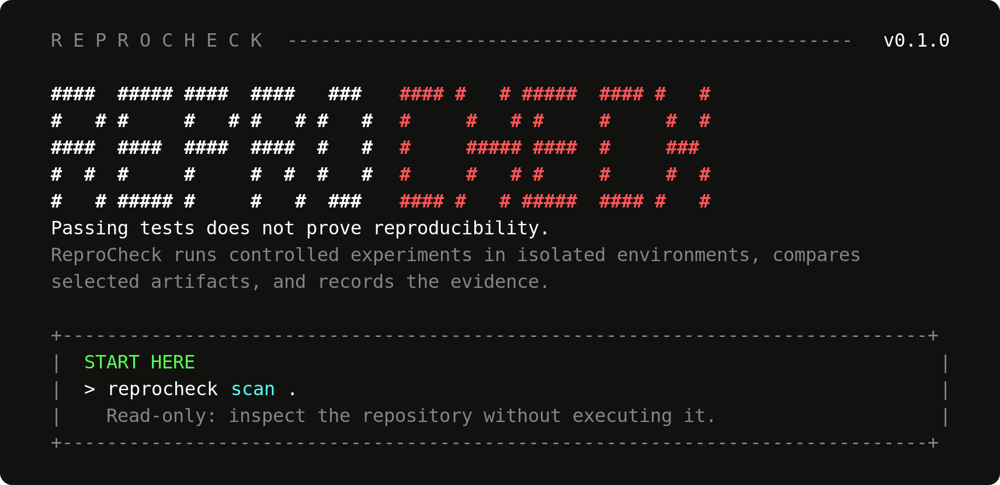
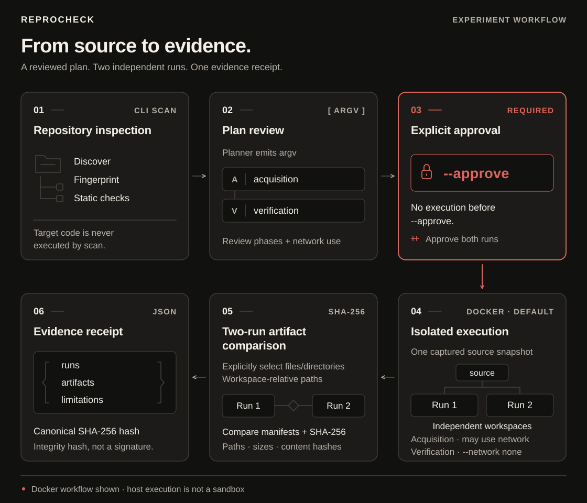
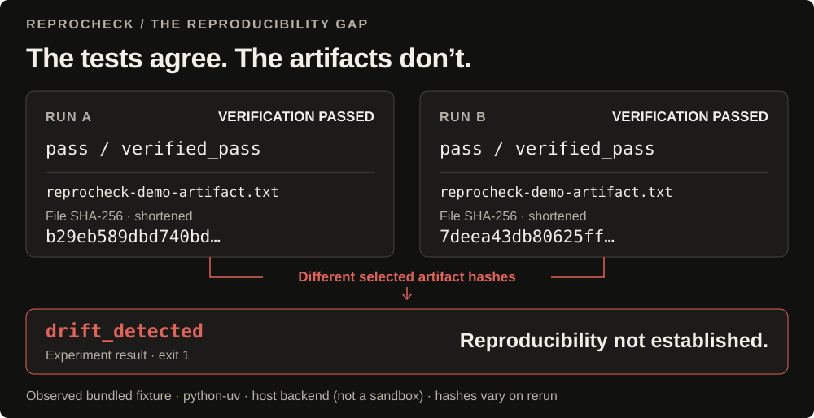

# ReproCheck presentation assets

Repository-local visuals embedded in the [root README](../../README.md).
These notes preserve capture provenance, verified conditions and reproduction
instructions. The snippets below are references for future presentation updates.

## 1. Real CLI welcome



- [PNG, 2× resolution](reprocheck-cli-welcome.png) — stable font rendering.
- [Self-contained SVG](reprocheck-cli-welcome.svg) — scalable alternative.
- [Capture/export script](render-welcome.py) — Python standard library only.

**Provenance.** This is a faithful SVG rendering of **actual CLI output**, then
rasterized to PNG; it is not a desktop screenshot or an imagined UI. The capture
script invokes the installed `reprocheck` entry point with no arguments in an
86-column POSIX pseudo-terminal. That reaches `cli.main()` →
[`render_welcome()`](../../src/reprocheck/welcome.py). It preserves emitted text,
ANSI styling, character positions and line breaks. ANSI bright colors use a
conventional terminal palette; exact shades vary by terminal theme. The PNG uses
DejaVu Sans Mono on a near-black background. The contiguous crop ends before
`WORKFLOW REFERENCE`; no terminal rows were rewritten or rearranged.

Regenerate the SVG after installing the project's locked environment:

```bash
uv run --locked --offline python docs/assets/render-welcome.py
```

The capture helper requires POSIX PTY support; it is not a PowerShell capture
script. The resulting images are platform-independent. PNG export used
CairoSVG 2.9.1, Cairo 1.16.0 and DejaVu fonts, with a scale factor of 2 for the
welcome image. These are optional asset-authoring tools, not CLI dependencies;
none were added to `pyproject.toml` or `uv.lock`.

**Root README placement:** immediately after the product introduction and short
navigation links. Describe it honestly as a rendering of the actual terminal.

```markdown


*Actual CLI output, faithfully rendered from an 86-column terminal capture.*
```

## 2. Approval-gated experiment workflow



[PNG alternative](reprocheck-experiment-workflow.png)

The numbered path reads across the top, then right-to-left along the bottom.
The diagram shows the Docker workflow, not the host capture environment. Its
semantics were checked against `cli.py` and `verification/`:

- Inspection performs discovery, fingerprinting and static checks; it does not
  execute repository commands.
- Planning exposes argv, acquisition/verification phases and network intent.
- `--approve` authorizes both experiment runs. No target execution occurs before
  approval.
- Two independent workspaces are materialized from one captured source snapshot.
- Docker acquisition may use the network. Verification uses `--network none`.
- Explicitly selected relative files/directories are compared using artifact
  manifests, paths, sizes and SHA-256 content hashes.
- JSON receipts retain observations and limitations with canonical SHA-256
  integrity metadata. A receipt hash is **not a signature**.

See [architecture](../architecture.md) and [security boundaries](../security-model.md).

```markdown

```

## 3. The reproducibility gap — observed, not simulated



[PNG alternative](reprocheck-drift-insight.png) ·
[Exact captured terminal excerpt](reprocheck-drift-output.txt)

**Validated conditions:** Debian Linux, Python 3.12.15, uv 0.13.0,
`python-uv` profile, **host backend with explicit risk acknowledgement**.
Docker was not installed in this environment, so this visual does not claim a
successful Docker-backed run. Host execution is not a sandbox and does not
enforce network isolation. Use it only for a fixture or repository you trust.

The [bundled fixture](../../examples/reproducibility-drift-python/tests/test_artifact.py)
writes a fresh `secrets.token_hex(16)` value and passes a length assertion. The
selected file contains 33 bytes, including its newline. Both runs' acquisition
and verification commands exited `0`; the experiment process exited `1` because
the selected artifact hashes differed.

Observed file SHA-256 values (the illustration shortens these, explicitly):

| Run | Full file SHA-256 |
|---|---|
| A | `b29eb589dbd740bde2da39fc86c2f6fc885e7d4d81f0fe76ca36ee8279ecf598` |
| B | `7deea43db80625ff0585eed892a72108edca13b0e134ce8b80d40e87639b54ea` |

These are **file content hashes**, not the artifact-manifest digests or the
receipt's canonical hash. Fresh executions should produce different values.

The corresponding captured source fingerprint was
`ba0a8941ed5794341e5ba9bb838805822e6404638e6f841c1bdcd550c4da5878`.
The generated receipt was successfully checked with `receipt validate` and
`--repository examples/reproducibility-drift-python`. Only the safe output
excerpt and observed hashes are included here; raw receipts, environment
metadata and local execution logs remain outside the repository.

### Reproduce the captured host workflow

After `uv sync --locked --dev`, preview the plan first:

```bash
uv run --locked reprocheck experiment examples/reproducibility-drift-python \
  --profile python-uv --backend host --allow-host-exec \
  --artifact reprocheck-demo-artifact.txt
```

The unapproved preview returns `1` and runs no target commands. Review the plan
and host-execution risk, then approve the trusted fixture explicitly:

```bash
uv run --locked reprocheck experiment examples/reproducibility-drift-python \
  --profile python-uv --backend host --allow-host-exec \
  --artifact reprocheck-demo-artifact.txt \
  --receipt experiment-receipt.json --format terminal --approve
```

Expect exit `1` for drift. Run validation separately, not behind `&&`:

```bash
uv run --locked --offline reprocheck receipt validate experiment-receipt.json \
  --repository examples/reproducibility-drift-python
```

Validation should print `valid` and return `0`. This confirms receipt integrity
and source-fingerprint correspondence, not the truthfulness or trustworthiness
of its producer. An actor who rewrites the content and its hash can create a new
integrity-valid receipt.

PowerShell uses the same options with backtick continuation instead of `\`;
the following single-line invocation avoids shell-specific continuation:

```powershell
uv run --locked reprocheck experiment examples/reproducibility-drift-python --profile python-uv --backend host --allow-host-exec --artifact reprocheck-demo-artifact.txt --receipt experiment-receipt.json --format terminal --approve
uv run --locked --offline reprocheck receipt validate experiment-receipt.json --repository examples/reproducibility-drift-python
```

Native PowerShell execution was **not** tested in this session. The recommended
isolated workflow uses `--backend docker` and omits `--allow-host-exec`; its
plan/options were inspected, but actual Docker execution was not tested here.
See the [guided Docker demo](../reproducibility-drift-demo.md) for both shells.

```markdown

```

## Presentation and verification decisions

- **No animation.** The welcome is a reading surface and the drift conclusion is
  a comparison. Static visuals keep the entire claim visible, avoid forced
  replay, and work without motion. A GIF would add little evidence here.
- SVGs use explicit dimensions/viewBoxes, embedded styles, descriptive titles
  and descriptions, and no scripts, external fonts, resources or filters.
- SVGs were rasterized and the resulting images inspected in the image viewer.
  PNG alternatives stabilize typography in renderers with different fonts.
- The CLI welcome was recaptured from the current implementation after its
  concurrent update. Its original bright-red wordmark and incidental green/cyan
  command accents were retained rather than recolored to match the diagrams.
- `make test` passed with **212 tests**, plus Ruff, formatting and strict mypy.
  This is a local check of the current working tree, not a CI-status claim.
- The root README embeds the PNG alternatives for reliable typography. SVG
  sources remain available here; all embedding paths are repository-relative.
